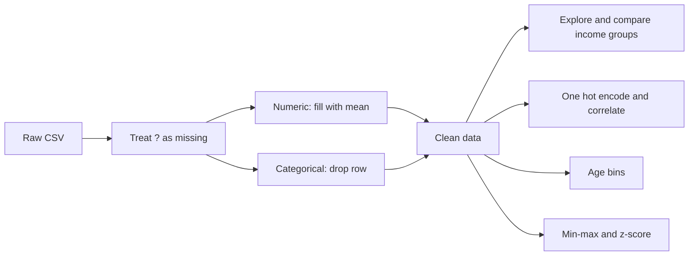

# Adult Census Data Preprocessing

A pandas notebook that takes the Adult Census dataset from raw to model ready. It finds hidden missing values, cleans and encodes the data, compares income groups, and applies discretization, min-max scaling and z-score standardization. I built it for DePaul coursework to practice the data preparation steps that come before any model.

## Results

| Step | Outcome |
|---|---|
| Raw data | 32,561 people, 12 columns |
| Hidden missing values found | 4,307 cells marked with "?" |
| Clean data | 30,162 rows with no missing values |
| One hot encoded | 42 numeric columns, ready for a model |
| Strongest link to income above $50K | Years of education, correlation 0.34 |

## How it works



1. **Find hidden gaps.** At first pandas reported no missing values, because the file uses "?" instead of blanks. Reloading with "?" as a missing marker revealed 1,843 missing occupations, 1,836 missing work classes, 583 missing countries and 45 missing ages.
2. **Clean.** Missing ages are filled with the mean. Rows missing a category are dropped, since guessing someone's job would add false information. Education as text and native country are dropped, because education years already carry the same signal.
3. **Explore.** Box plots, histograms and cross tabs show how work class, age, education and hours relate to income. People earning above $50K are older on average, 44 against 37, have about two more years of education, and work longer weeks, 46 hours against 39.
4. **Encode.** One hot encoding turns every category into numeric columns, giving 42 columns and a full correlation matrix.
5. **Discretize.** Age is split into young up to 30, mid age up to 55, and old above 55.
6. **Normalize.** Education years are scaled to the range 0 to 1 with min-max scaling. Age, hours and education years are also standardized to z-scores. A side by side table compares raw, min-max and z-score values for hours worked.

## What I learned

* **Missing data can hide.** A quick null count said the data was complete. Only checking how the file marks gaps showed over 4,000 missing cells.
* **How you fill gaps is a choice.** Filling a number with the mean keeps the row. Dropping rows with a missing category avoids inventing facts about a person.
* **Scaling changes the picture, not the order.** Min-max keeps values between 0 and 1 but is sensitive to outliers. Z-scores show how far each value sits from the average, which suits models that assume centered data.

## Tech stack

Python, pandas, NumPy, Matplotlib, Seaborn

## Running it

```bash
pip install -r requirements.txt
jupyter notebook project1.ipynb
```

The notebook expects the course's Adult Census CSV, `adult-modified-09-13-2025.csv`, in the same folder. It saves `adult_clean_no_missing.csv` and `adult_numeric.csv` as outputs.

## Author

Siddhesh Patil, MS in Artificial Intelligence, DePaul University
